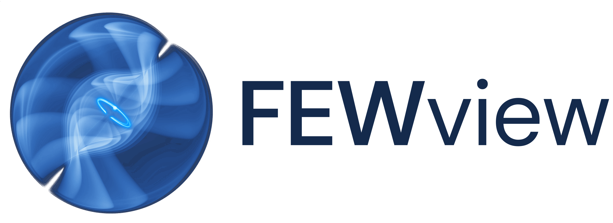
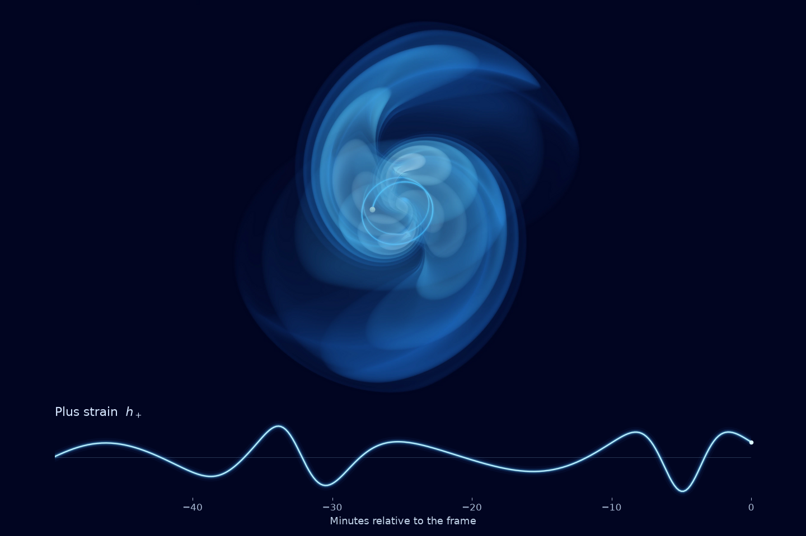

<h1>
  <picture>
    <source media="(prefers-color-scheme: dark)" srcset="https://raw.githubusercontent.com/bleather/FEWview/main/docs/img/FEWview-on-dark.png">
    
  </picture>
</h1>

FEWview renders the gravitational waves from an extreme mass-ratio inspiral.
It takes the radiative modes from FastEMRIWaveforms (FEW) and evaluates the
strain in every direction around the binary. Radius measures look-back time.
In a still, a crest near the edge left the source earlier than one near the centre.



The four frames follow one crest of the plus polarisation to the next, seen
from 18° above the orbital plane. The trace below shows an hour of strain
along that line of sight. The shaded interval is the cycle pictured above.

## Installation

Use Python 3.12 or later. On macOS, FEW supplies wheels for Apple Silicon
(macOS 14 or later). Use a native arm64 Python environment there. From a checkout, run

```bash
python -m pip install .
```

To install directly from GitHub, run

```bash
python -m pip install "git+https://github.com/bleather/FEWview.git"
```

Pip installs the public CPU build of FEW 2.2.x. On x86-64 Linux the minimum
is 2.2.1.post1, which fixes CPU compatibility in the published wheels.
FEW downloads the data for each model
on first use. The default eccentric Kerr model needs about 5 GB for its
amplitude table. The circular example below uses a few MB.

On a headless Ubuntu machine, install the
[Mesa rendering libraries](https://github.com/bleather/FEWview/blob/main/docs/index.md#first-render)
before making a 3D still or movie.

## Render a waveform

This example follows a ten-solar-mass secondary on a circular orbit around a
million-solar-mass primary. It uses the post-adiabatic `Circ1PAT1R` model.

```bash
fewview-render --model Circ1PAT1R --M 1e6 --mu 10 --a 0.00001 \
  --p0 10 --e0 0 --chi2 0.3 --T 0.0002 --dt 10 \
  --grid-resolution 64 --opacity-profile shells --output-dir circular
```

Open `circular/relativistic-emri-volume.png` for the still or
`circular/relativistic-volume-slice.png` for a cut through the orbital axis.
The same run saves the modes, so you can change the camera or make a movie
without generating the inspiral again.

```bash
fewview-animate circular/relativistic-modes.npz --output circular/orbit.mp4 \
  --frames 48 --fps 24 --animation-cycles 2 --grid-resolution 64 \
  --opacity-profile shells --presentation shells_dramatic --color-scheme ice \
  --camera-latitude 18 --camera-longitude -35 \
  --source-glow --waveform-glow --no-waveform-transparent
```

For an eccentric Kerr inspiral, `fewview-render --output-dir kerr` uses
`FastKerrEccentricEquatorialFlux` with spin 0.9 and initial eccentricity 0.4.
The tutorial works through this case in Python, including the choice of
retarded-time window, polarisation and viewing angle.

[Python tutorial](https://github.com/bleather/FEWview/blob/main/docs/tutorial.md) ·
[Example notebook](https://github.com/bleather/FEWview/blob/main/examples/tutorial.ipynb) ·
[Model and API guide](https://github.com/bleather/FEWview/blob/main/docs/reference.md) ·
[Rendering on Slurm](https://github.com/bleather/FEWview/blob/main/docs/cluster_rendering.md)

Figures and movies carry the FEWview wordmark in the lower-right corner.
Use `--logo icon` (or `logo="icon"` in Python) for the orbit symbol alone.

## Citation

If you use FEWview to make a figure or movie for a paper, please cite the
version you used. For v0.2.0, use the following reference.

> Leather, B. (2026). *FEWview* (v0.2.0) [Software]. [GitHub release](https://github.com/bleather/FEWview/releases/tag/v0.2.0).

For BibTeX, select **Cite this repository** on the GitHub repository page.
Please also cite FastEMRIWaveforms and the waveform model you used to generate
the inspiral. [FEW citation guide](https://github.com/BlackHolePerturbationToolkit/FastEMRIWaveforms#citation)

## Acknowledgements

The outgoing-wave visualisation follows the approach used for numerical
relativity waveforms in gwpv (Nils Vu) and ROSE. FEW supplies the inspiral
trajectories and amplitudes. [gwpv](https://github.com/nilsvu/gwpv)

FEWview is released under the [MIT licence](https://github.com/bleather/FEWview/blob/main/LICENSE).
