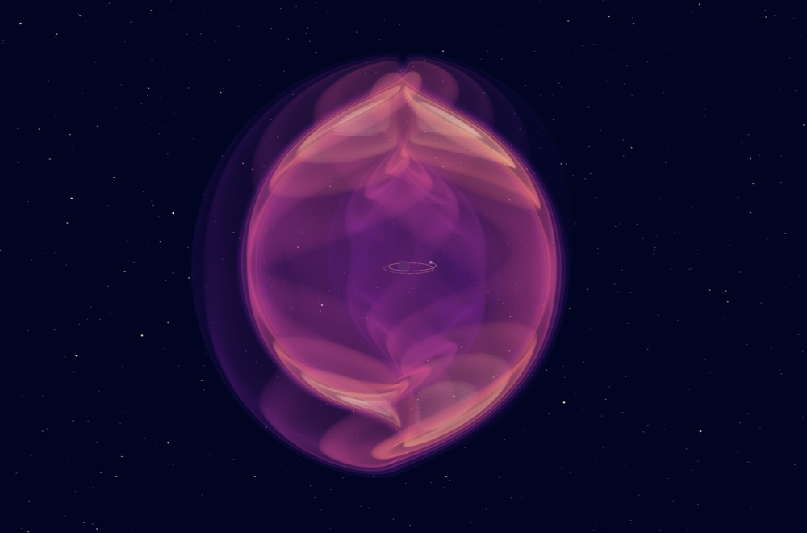

# FEWview

FEWview draws an EMRI waveform on a sphere. At each point the field is a sum of
radiative modes weighted by spin-weighted spherical harmonics, evaluated at
retarded time. The radius of the sphere sets how much waveform history fits
on screen. The colour shows the radiative waveform evaluated at that delay.
The orbit drawn in the centre has a separate display scale.



## First render

In a Python 3.12 or later environment, install from a checkout with
`python -m pip install .`. To install without cloning the repository yourself,
use `python -m pip install "git+https://github.com/bleather/FEWview.git"`.
You can also pass the path to a release wheel directly to pip.
On macOS use a native arm64 Python on macOS 14 or later, the platform covered
by the [public FEW wheels](https://pypi.org/project/fastemriwaveforms/#files).

```bash
fewview-render --model Circ1PAT1R --a 0.00001 --chi2 0.3 --p0 10 --e0 0 \
  --T 0.0002 --grid-resolution 64 --output-dir circular
```

The output directory contains a PNG of the volume, a slice through it and a
portable NumPy archive of the modes. FEW downloads the model data on first
use and caches it locally. An off-screen VTK/OpenGL backend is needed for the
3D still. On a machine without one, add `--no-render-volume` to generate the
slice and mode archive.

- [Generate the modes, choose a time window and render a movie in Python](tutorial.md)
- [Look up waveform models, units, data products and commands](reference.md)
- [Split a long animation across a Slurm array](cluster_rendering.md)
