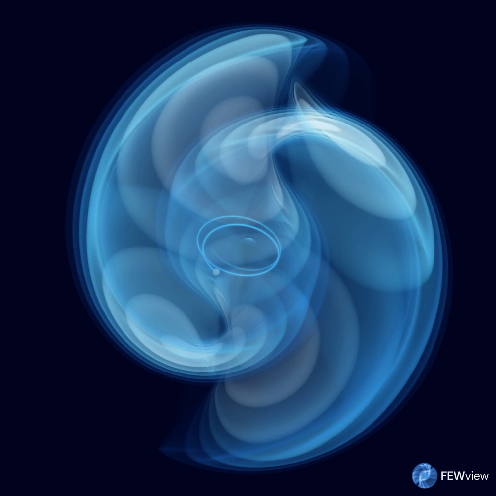
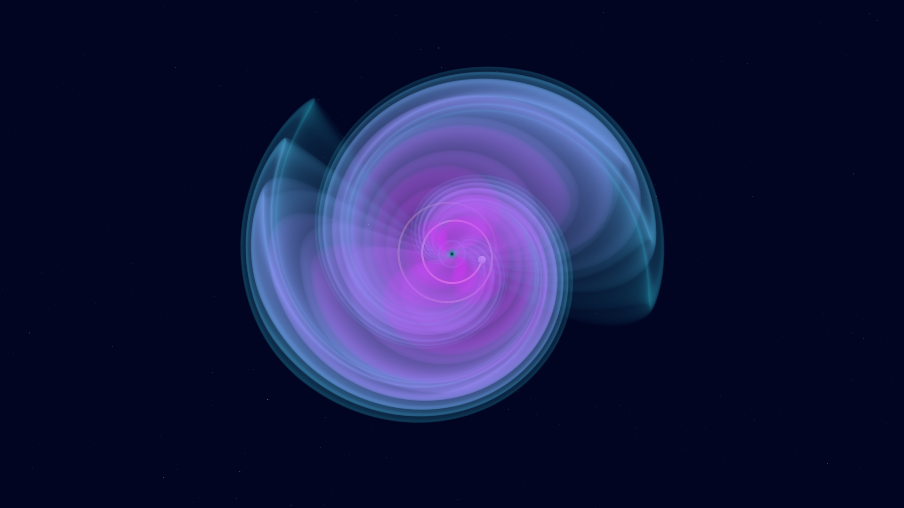
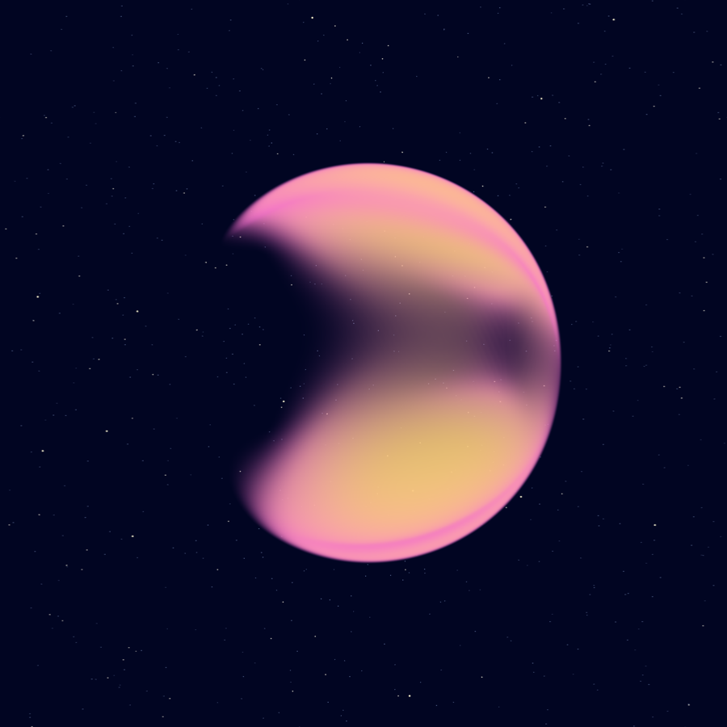

# Python tutorial

This walkthrough renders a still and a short movie from a FEW EMRI waveform. The [example notebook](https://github.com/bleather/FEWview/blob/main/examples/tutorial.ipynb)
explores other palettes for the same rendering functions. Follow the [installation instructions](index.md#installation)
before running the examples below.

## 1. Generate a waveform

`generate_relativistic_mode_waveform` runs the fully relativistic
`FastKerrEccentricEquatorialFlux` model and returns a `RelativisticModeWaveform`
carrying the individual radiative modes and the FEW inspiral trajectory.
The Kerr amplitude table takes about 5 GB on disk.

```python
import numpy as np
import fewview as fv

waveform = fv.generate_relativistic_mode_waveform(
    M=1.0e6, mu=10.0, a=0.9, p0=12.0, e0=0.4, xI0=1.0,
    dt=10.0, T=0.01, lmax=10, nmax=55,
)
```

The amplitude model is trained up to `nmax=55`. Requesting a larger value emits
a warning and falls back to the trained set, so at high eccentricity some
high-overtone content is unavoidably missing.

## 2. Choose how much history to show

The sphere maps waveform history from its centre (the current frame) to its
edge. `choose_max_delay` picks a span holding a resolvable number of wave
cycles; a small number keeps the shells cleanly separated.

```python
latitude, longitude = 18.0, -35.0
theta, phi = np.deg2rad([90.0 - latitude, longitude])
reference = waveform.strain(theta=theta, phi=phi)
h_plus, h_cross = np.real(reference), -np.imag(reference)

period = fv.estimate_waveform_period(waveform.time, h_plus, h_cross)
max_delay = fv.choose_max_delay(waveform.time, h_plus, h_cross, wave_cycles=1.5)
end = float(waveform.time[-1])
```

## 3. Render a still

The [opening figure](index.md) uses ice-blue shells for the plus polarisation.
To get that view, set the camera latitude to 18° above the orbital plane
and its longitude to −35°. The panel takes polar angle and azimuth in radians.
Use the same `theta` and `phi` as in the previous step to plot the strain
along the camera’s line of sight.

```python
fv.render_mode_frame(
    waveform,
    screenshot="tutorial-shells.png",
    max_delay=max_delay,
    frame_time=end,
    waveform_start_time=max(float(waveform.time[0]), end - 3600.0),
    waveform_end_time=end, waveform_theta=theta, waveform_phi=phi,
    resolution=200,
    component="plus",
    opacity_profile="shells",
    color_scheme="ice",
    presentation="shells_dramatic",
    opacity=0.30,
    camera_latitude=latitude, camera_longitude=longitude,
    camera_zoom=0.95,
    shell_count=7, shell_min=0.10, shell_max=0.92,
    smooth_sigma=1.2,
    inner_window_fraction=0.10, outer_window_fraction=0.10,
    source_glow=True, trajectory_color="#33baff",
    waveform_glow=True, waveform_transparent=False,
    window_size=(1000, 620),
)
```

The central bodies are drawn on the scale of the orbit. The fading cyan
trail follows the secondary’s recent trajectory. `source_glow=True` lights
the edge of the central black hole and draws the trail as a tube that can pass
behind it. Increase `body_exaggeration` to make the horizon marker larger
relative to the orbit. The lighting and marker size are for visibility.

[](images/ice-orbit-lobes.jpg)

This frame from an eccentric Kerr movie shows how the translucent lobes
overlap along an oblique line of sight.

## 4. A different look: face-on

`camera_view="face_on"` looks straight down the spin axis, revealing the spiral
wavefront pattern. This example keeps the `shells` profile and uses the
blue-to-magenta `cool` palette.

```python
fv.render_mode_frame(
    waveform, screenshot="tutorial-faceon.png",
    max_delay=max_delay, frame_time=end,
    waveform_start_time=end - 8 * period, waveform_end_time=end,
    resolution=200,
    component="plus", opacity_profile="shells", color_scheme="cool",
    presentation="shells_dramatic", opacity=0.30, camera_view="face_on", camera_zoom=1.1,
    shell_count=7, shell_min=0.10, shell_max=0.92, smooth_sigma=1.2,
    inner_window_fraction=0.10, outer_window_fraction=0.10,
    trajectory_color="#00b7ff", window_size=(760, 760),
)
```



## 5. A different field: energy flux

The looks above render the strain (`component="plus"`), but FEWview can also
show the outgoing energy flux `|dh/dt|²`. Pair `component="energy_flux"` with
`opacity_profile="flux"`: the profile keeps the dim troughs between wavefronts
transparent and lets only the bright crests turn solid, so the flux reads as a
set of nested luminous shells with the lower-flux regions showing through instead
of a filled ball. It looks best with `presentation="shells_dramatic"` and an
oblique camera, and the structure is strongest at higher eccentricity.

```python
fv.render_mode_frame(
    waveform, screenshot="tutorial-flux.png",
    max_delay=max_delay, frame_time=end,
    waveform_start_time=end - 8 * period, waveform_end_time=end,
    resolution=200,
    component="energy_flux", opacity_profile="flux", color_scheme="plasma",
    presentation="shells_dramatic", color_exposure=2.2,
    camera_view="oblique", camera_zoom=0.62, smooth_sigma=0.7,
    inner_window_fraction=0.10, outer_window_fraction=0.10,
    trajectory_color="#00e0ff", window_size=(900, 900),
)
```



Two settings control the flux display. `flux_threshold` sets how bright a crest must be
before it becomes solid (raise it to isolate the brightest lobes), and
`flux_gamma` lifts the dim inter-crest flux into the bright half of the colour
map. The defaults (`0.35` and `0.6`) are tuned for these EMRI fluxes.

## 6. Diagnostic slice

Before a full render, a coordinate-plane slice is a fast way to inspect the
field:

```python
volume = fv.build_mode_retarded_time_volume(
    waveform, frame_time=end, max_delay=max_delay, resolution=160,
    inner_window_fraction=0.10, outer_window_fraction=0.10,
)
fig, _ = fv.plot_volume_slice(volume, component="plus", plane="xz")
```

## 7. A short animation

`render_mode_animation` sweeps a range of frame times to an MP4, reusing the
angular basis across frames and holding the colour scale fixed so the movie does
not flicker.

```python
anim_end = end
anim_start = max(float(waveform.time[0] + max_delay), anim_end - 2.0 * period)

fv.render_mode_animation(
    waveform, "tutorial.mp4",
    max_delay=max_delay, start_time=anim_start, end_time=anim_end,
    frames=48, fps=24, resolution=110,
    component="plus", opacity_profile="shells", color_scheme="ice",
    presentation="shells_dramatic", opacity=0.30, camera_zoom=0.95,
    shell_count=7, smooth_sigma=1.2,
    inner_window_fraction=0.10, outer_window_fraction=0.10,
    camera_latitude=latitude, camera_longitude=longitude,
    show_bodies=True, show_trajectory=True, source_glow=True, trajectory_color="#33baff",
    show_waveform=True, waveform_theta=theta, waveform_phi=phi,
    waveform_glow=True, waveform_transparent=False,
    window_size=(640, 400), normalization_samples=3,
)
```

`waveform_glow=True` lights up the part of the strain trace the animation has
already played. The rest of the trace stays dim so you can see where the orbit
sits in the cycle. To put the trace beneath the orbit, set
`waveform_transparent=False`. The panel uses Computer Modern math by default.
Both options also work in `render_mode_frame`. For a still, set
`waveform_start_time` and `waveform_end_time` to choose the interval in the panel.
The animation and cluster commands accept `--waveform-glow` and
`--no-waveform-transparent`.

`--animation-cycles` (via `start_time`/`end_time` here) sets how much inspiral
is traversed; the frame count sets how smoothly. Aim for at least ~20 frames per
wave cycle, or the wave pattern strobes.

The same call renders the energy flux in motion. The `flux` profile
self-normalizes each frame (a single fixed colour scale would be dominated by
the periapsis burst and blank the quieter frames), so the outgoing flux shells
stay visible as they propagate outward:

```python
fv.render_mode_animation(
    waveform, "tutorial-flux.mp4",
    max_delay=max_delay, start_time=anim_start, end_time=anim_end,
    frames=30, fps=15, resolution=120,
    component="energy_flux", opacity_profile="flux", color_scheme="plasma",
    presentation="shells_dramatic", color_exposure=2.2,
    camera_view="oblique", camera_zoom=0.62, smooth_sigma=0.7,
    inner_window_fraction=0.10, outer_window_fraction=0.10,
    trajectory_color="#00e0ff",
    show_bodies=True, show_trajectory=True, show_waveform=True,
    window_size=(700, 640),
)
```

## Choosing settings

| knob | options | notes |
| --- | --- | --- |
| `component` | `plus`, `cross`, `amplitude`, `energy_flux` | `cross` is zero on the equatorial plane; `amplitude` is basis-independent |
| `opacity_profile` | `soft`, `bands`, `shells`, `flux` | `shells` needs `plus`/`cross`; `flux` needs `energy_flux` |
| `color_scheme` | `plasma`, `rainbow`, `ice`, etc. | `fv.available_color_schemes()` lists them |
| `presentation` | `balanced`, `dramatic`, `shells_dramatic` | preset lighting, exposure, starfield |
| `camera_view` | `oblique`, `face_on` | `face_on` looks down the spin axis |
| `camera_azimuth`, `camera_elevation` | degrees | orbit/tilt the camera on top of `camera_view` (`camera_zoom` frames it) |
| `camera_latitude`, `camera_longitude` | degrees | absolute view: latitude above the equatorial plane, azimuth from `+x`; overrides `camera_view` |
| `camera_latitude_end`, `camera_longitude_end` | degrees | animations only: fly the camera to this absolute angle by the final frame |
| `camera_loop` | `True`/`False` | animations only: fly a full 360° and rise to `camera_latitude_end` (the peak) then back, ending on the opening view |
| `waveform_transparent` | `True`/`False` | `True` (default) composites the strain panel over the scene so the background shows through; `False` is the opaque strip below |

## Two physical caveats

- **The polar axis** carries a faint, unavoidable seam. A spin-2 field has no
  continuous scalar representation over the poles, so `plus`/`cross` are
  multivalued there. It is faint obliquely and softened by `smooth_sigma`;
  raising `resolution` makes it sharper, not fainter. `amplitude` and
  `energy_flux` are immune.
- **The equatorial gap** for `component="cross"` is physical, not a bug:
  the cross polarisation vanishes on the equatorial plane for an
  equatorial orbit. Use `plus` to avoid it.

## Cluster rendering

For long, high-resolution movies the per-frame CPU cost dominates and the work
is serial within a task, so split across many Slurm array tasks with
`fewview-cluster-job`. See [cluster_rendering.md](cluster_rendering.md).
